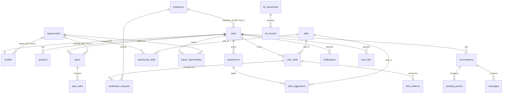

# BAWSALA database schema

Source of truth: `db/migrations/001_init.sql`, `002_knowledge_ops.sql`, `003_ai_ops.sql`. This document describes those files and the code that uses them; if they disagree, the SQL wins.

## 1. Overview

| Item | Value |
|---|---|
| Engine | PostgreSQL 15+ |
| Extensions | `pgcrypto` (`gen_random_uuid()`, `gen_random_bytes()`), `citext` (case-insensitive email), `vector` (pgvector, `vector(384)` + HNSW index, so pgvector ≥ 0.5), `pg_trgm` (trigram search) |
| Migration runner | `scripts/migrate.ts`, run with `npm run db:migrate` (`tsx scripts/migrate.ts`) |
| Full setup | `npm run setup` runs `db:migrate`, `db:seed` (skills catalogue + demo opportunities) and `kb:ingest` (knowledge base) |
| Required env | `DATABASE_URL`; `DATABASE_SSL=true` enables TLS (`rejectUnauthorized: false`) |

**How the runner works:** it creates `schema_migrations(name text PK, applied_at timestamptz)` if missing, then reads `db/migrations/*.sql` in filename order. Each file not yet in `schema_migrations` is run inside its own transaction (`BEGIN` → file → insert name → `COMMIT`). If a file fails, it is rolled back and the runner exits with code 1. There are no down-migrations. `GET /api/health/ready` reports `max(name)` from `schema_migrations`.

**Helper SQL functions (001):**

| Function | Returns |
|---|---|
| `app_user_id()` | `current_setting('app.user_id', true)` as `uuid`, or NULL when empty |
| `app_is_system()` | `true` when `current_setting('app.role', true) = 'system'` |
| `touch_updated_at()` | trigger that sets `NEW.updated_at = now()` (on `users`, `profiles`, `experiences`, `user_skills`, `opportunities`, `kb_documents`) |

**Request scoping (`src/server/db/index.ts`):** every query runs in a short transaction that first calls `set_config(..., true)` (transaction-local). There is no unscoped query function.

| Wrapper | `app.user_id` | `app.role` | Effect under RLS |
|---|---|---|---|
| `asUser(userId, fn)` | the user's uuid (validated) | `user` | owner policies match only that user's rows |
| `asSystem(fn)` | `''` | `system` | `app_is_system()` is true, so every policy allows access |
| `asPublic(fn)` | `''` | `public` | only `USING (true)` / `read_active` policies match (reference data) |

## 2. Tables

Conventions: `uuid` PKs default to `gen_random_uuid()`, `bigserial` for append-only logs. `now()` = `NOT NULL DEFAULT now()`. "→ X (CASCADE)" is a foreign key with its `ON DELETE` action.

### 2.1 Accounts & auth

**`institutions`**: schools and organisations that students can join.

| Column | Type | Constraints / default | Meaning |
|---|---|---|---|
| id | uuid | PK | |
| name | text | NOT NULL, length 2–200 | |
| city | text | | |
| join_code | text | UNIQUE NOT NULL, default first 8 hex chars of `gen_random_bytes(6)`, uppercased | code students enter at sign-up or in settings (matched with `upper($1)`) |
| created_at | timestamptz | now() | |

**`users`**: enum `user_role = ('student','institution_admin','platform_admin')`.

| Column | Type | Constraints / default | Meaning |
|---|---|---|---|
| id | uuid | PK | |
| email | citext | UNIQUE NOT NULL, length ≤ 254 | stored lower-cased by the app |
| password_hash | text | NOT NULL | `scrypt$N$r$p$salt$key` (N=2^15, r=8, p=3, 64-byte key). Hashes with older parameters are re-hashed at the next successful sign-in. |
| name | text | NOT NULL, length 1–120 | |
| locale | text | NOT NULL default `'ar'`, IN (`ar`,`ary`,`fr`,`en`,`zgh`) | UI and email language |
| role | user_role | NOT NULL default `student` | sign-up always creates `student`. `platform_admin` is granted by an operator with `npm run admin:grant -- <email>` (`scripts/make-admin.ts`; `--revoke` sets the account back to `student`; both reset the user's sessions and write an `admin.granted`/`admin.revoked` audit entry). `institution_admin` is set with `PATCH /api/v1/admin/users/:id`. |
| institution_id | uuid | → institutions (SET NULL) | |
| email_verified_at | timestamptz | | not written by current code |
| last_active_at | timestamptz | | updated by session validation, at most every 10 min |
| created_at / updated_at | timestamptz | now(); `users_touch` trigger | |

**`sessions`**

| Column | Type | Constraints / default | Meaning |
|---|---|---|---|
| id | text | PK | SHA-256 hex of the cookie token (raw token only exists in the cookie) |
| user_id | uuid | NOT NULL → users (CASCADE) | |
| created_at | timestamptz | now() | |
| expires_at | timestamptz | NOT NULL | 30 days from creation; extended to now+30 d when < 15 d remain, but never past `created_at` + 90 d (sessions older than 90 d are deleted on use) |
| last_seen_at | timestamptz | now() | updated on renewal |
| user_agent | text | | truncated to 300 chars |
| ip | text | | truncated to 64 chars |

**`auth_tokens`**: one-time emailed tokens.

| Column | Type | Constraints / default | Meaning |
|---|---|---|---|
| id | text | PK | SHA-256 of the emailed token |
| user_id | uuid | NOT NULL → users (CASCADE) | |
| purpose | text | NOT NULL, IN (`password_reset`,`email_verify`) | only `password_reset` is issued (valid 1 h) |
| expires_at | timestamptz | NOT NULL | |
| used_at | timestamptz | | set on use; a used token cannot be reused |
| created_at | timestamptz | now() | |

**`rate_limits`**: fixed-window counters (`src/server/ratelimit.ts`).

| Column | Type | Constraints / default | Meaning |
|---|---|---|---|
| key | text | PK part | e.g. `signin:ip:<ip>`, `signin:fail:<email>`, `chat:min:<userId>`, `chat:day:<userId>` (the daily AI quota). Keys contain IP addresses and emails. |
| window_start | timestamptz | PK part | start of the window, aligned to the window length |
| count | integer | NOT NULL default 0 | incremented with `INSERT … ON CONFLICT DO UPDATE` |

Rows older than 1 day, and expired `sessions`, are deleted by `pruneRateLimits()`. It runs in the daily cron and on about 5 % of sign-ins.

### 2.2 Profile & experiences

**`profiles`**: one row per user, created at sign-up (or lazily on first read).

| Column | Type | Constraints / default | Meaning |
|---|---|---|---|
| user_id | uuid | PK → users (CASCADE) | |
| situation | text | IN (`student`,`graduate`,`job_seeker`,`employed`,`other`) | |
| field_of_study | text | length ≤ 160 | |
| education_level | text | IN (`bac`,`bac2`,`licence`,`master`,`doctorate`,`vocational`,`other`) | |
| school | text | length ≤ 200 | |
| graduation_year | smallint | 1970–2100 | |
| city | text | length ≤ 120 | |
| languages | text[] | NOT NULL default `{}` | |
| goal | text | length ≤ 600 | |
| target_opportunity_id | uuid | → opportunities (SET NULL), FK `profiles_target_fk` | current target role |
| share_with_institution | boolean | NOT NULL default false | opt-in to institution stats and the verification queue |
| onboarded_at | timestamptz | | set once (`coalesce`) when onboarding completes |
| updated_at | timestamptz | now(); trigger | |

**`experiences`**: things the student did, in their own words.

| Column | Type | Constraints / default | Meaning |
|---|---|---|---|
| id | uuid | PK | |
| user_id | uuid | NOT NULL → users (CASCADE) | |
| kind | text | NOT NULL, IN (`job`,`internship`,`volunteer`,`project`,`family`,`club`,`education`,`course`,`other`) | |
| title | text | NOT NULL, length 1–200 | |
| organization | text | length ≤ 200 | |
| description | text | NOT NULL, length 1–4000 (API requires ≥ 10) | input for skill extraction |
| started_on / ended_on | date | | |
| analyzed_at | timestamptz | | set by analysis; reset to NULL when the experience is edited |
| created_at / updated_at | timestamptz | now(); trigger | |

### 2.3 Skills passport

**`skills`**: the reference catalogue, seeded by `npm run db:seed`.

| Column | Type | Constraints / default | Meaning |
|---|---|---|---|
| id | text | PK, `^[a-z0-9_]{2,40}$` | |
| category | text | NOT NULL | |
| names | jsonb | NOT NULL | `{"en","fr","ar","ary"?,"zgh"?}` |
| learn_url | text | | free learning resource |
| learn_title | jsonb | | localized title |
| learn_hours | smallint | | |

**`user_skills`**: enum `skill_status = ('declared','inferred','evidenced','verified')` (see §3).

| Column | Type | Constraints / default | Meaning |
|---|---|---|---|
| id | uuid | PK | |
| user_id | uuid | NOT NULL → users (CASCADE) | |
| skill_id | text | NOT NULL → skills (NO ACTION) | |
| status | skill_status | NOT NULL | |
| level | smallint | NOT NULL default 1, 1–4 | not written by current code |
| source | text | NOT NULL, IN (`user`,`ai`,`rules`) | who first added it (not changed by later upgrades) |
| created_at / updated_at | timestamptz | now(); trigger | |
| | | UNIQUE (user_id, skill_id) | |

**`skill_evidence`**

| Column | Type | Constraints / default | Meaning |
|---|---|---|---|
| id | uuid | PK | |
| user_id | uuid | NOT NULL → users (CASCADE) | |
| user_skill_id | uuid | NOT NULL → user_skills (CASCADE) | |
| kind | text | NOT NULL, IN (`quote`,`project`,`link`,`certificate`,`task`) | `quote` comes from an accepted suggestion; `task` from a completed plan task |
| experience_id | uuid | → experiences (SET NULL) | |
| plan_task_id | uuid | **no FK** | the plan task that produced the proof |
| text | text | length ≤ 2000 | |
| url | text | NULL or `^https?://` and length ≤ 2000 | |
| created_at | timestamptz | now() | |

**`skill_suggestions`**: proposals waiting for the student's yes/no. Nothing enters the passport without consent.

| Column | Type | Constraints / default | Meaning |
|---|---|---|---|
| id | uuid | PK | |
| user_id | uuid | NOT NULL → users (CASCADE) | |
| skill_id | text | NOT NULL → skills | |
| experience_id | uuid | → experiences (CASCADE) | NULL when produced by the assistant's `analyze_skills` from free text |
| quote | text | NOT NULL, length ≤ 1000 | verbatim text that shows the skill |
| reason | text | length ≤ 600 | |
| source | text | NOT NULL, IN (`ai`,`rules`) | |
| status | text | NOT NULL default `pending`, IN (`pending`,`accepted`,`rejected`) | |
| created_at | timestamptz | now() | |
| | | UNIQUE (user_id, skill_id, experience_id) | rows with NULL `experience_id` are not deduplicated (NULLs are distinct) |

### 2.4 Opportunities

**`opportunities`**: jobs, internships, trainings and programmes. Public reference data.

| Column | Type | Constraints / default | Meaning |
|---|---|---|---|
| id | uuid | PK | |
| slug | text | UNIQUE | set by the seed only |
| title | jsonb | NOT NULL | localized |
| organization | text | NOT NULL | |
| city | text | | |
| remote | boolean | NOT NULL default false | |
| kind | text | NOT NULL, IN (`job`,`internship`,`training`,`volunteer`,`program`) | |
| description | jsonb | NOT NULL default `{}` | localized |
| project_brief | jsonb | | localized "Day 30" portfolio project |
| apply_url | text | NULL or `^https?://` | |
| source_name | text | NOT NULL | |
| source_url | text | NULL or `^https?://` | |
| is_sample | boolean | NOT NULL default false | demo data, always labelled in the UI |
| status | text | NOT NULL default `published`, IN (`draft`,`published`,`archived`) | |
| source_updated_at | timestamptz | now() | bumped on admin edit |
| expires_at | timestamptz | | |
| created_by | uuid | → users (SET NULL) | |
| created_at / updated_at | timestamptz | now(); trigger | |
| verification_status *(002)* | text | NOT NULL default `unverified`, IN (`verified`,`unverified`,`demo`) | |
| last_verified_at *(002)* | timestamptz | | set to now() when saved as `verified` |
| eligibility *(002)* | jsonb | | localized |
| deadline *(002)* | date | | |
| published_at *(002)* | date | | |
| | | CHECK `is_sample OR source_url IS NOT NULL` | real opportunities must cite a source |
| | | CHECK `opp_demo_consistent`: `(verification_status = 'demo') = is_sample` | |

Students only see rows with `status='published'`, `expires_at` NULL or in the future, and `deadline` NULL or ≥ today, both in listings (`listOpportunities`) and in single lookups (`getOpportunity`). Admin opportunity writes are rejected (422) if any requirement `skill_id` is not in `skills`.

**`opportunity_skills`**

| Column | Type | Constraints / default | Meaning |
|---|---|---|---|
| opportunity_id | uuid | PK part → opportunities (CASCADE) | |
| skill_id | text | PK part → skills | |
| required | boolean | NOT NULL default true | false means nice-to-have |

**`saved_opportunities`**

| Column | Type | Constraints / default | Meaning |
|---|---|---|---|
| user_id | uuid | PK part → users (CASCADE) | |
| opportunity_id | uuid | PK part → opportunities (CASCADE) | |
| status | text | NOT NULL default `saved`, IN (`saved`,`preparing`,`applied`) | current code only writes `saved`; `preparing` and `applied` are never set |
| created_at | timestamptz | now() | |

### 2.5 Plans

**`plans`**

| Column | Type | Constraints / default | Meaning |
|---|---|---|---|
| id | uuid | PK | |
| user_id | uuid | NOT NULL → users (CASCADE) | |
| opportunity_id | uuid | → opportunities (SET NULL) | |
| title | text | NOT NULL, length ≤ 200 | |
| status | text | NOT NULL default `active`, IN (`active`,`completed`,`archived`) | at most one `active` per user (partial unique index) |
| starts_on | date | NOT NULL default `current_date` | |
| ends_on | date | NOT NULL | `current_date + days − 1` |
| created_at | timestamptz | now() | |

Saving a new plan archives the current active plan (plans are never deleted). A plan becomes `completed` when it has no open tasks. Reopening a task sets a `completed` plan back to `active`.

**`plan_tasks`**

| Column | Type | Constraints / default | Meaning |
|---|---|---|---|
| id | uuid | PK | |
| plan_id | uuid | NOT NULL → plans (CASCADE) | |
| user_id | uuid | NOT NULL → users (CASCADE) | denormalised for RLS |
| position | smallint | NOT NULL | 1-based order (at most 40 tasks saved) |
| kind | text | NOT NULL, IN (`learn`,`practice`,`prove`,`apply`,`project`) | |
| title | text | NOT NULL, length ≤ 300 | |
| detail | text | length ≤ 2000 | |
| skill_id | text | → skills | |
| resource_url | text | | |
| estimated_minutes | smallint | | |
| due_on | date | NOT NULL | |
| completed_at | timestamptz | | |
| proof_url | text | NULL or `^https?://` | |
| proof_note | text | length ≤ 2000 | |

### 2.6 Assistant

**`conversations`**

| Column | Type | Constraints / default | Meaning |
|---|---|---|---|
| id | uuid | PK | |
| user_id | uuid | NOT NULL → users (CASCADE) | |
| title | text | NOT NULL default `''`, length ≤ 160 | defaults to the first 60 chars of the first message |
| created_at / updated_at | timestamptz | now() | `updated_at` is bumped by every new message (no trigger) |

**`messages`**

| Column | Type | Constraints / default | Meaning |
|---|---|---|---|
| id | uuid | PK | |
| conversation_id | uuid | NOT NULL → conversations (CASCADE) | |
| user_id | uuid | NOT NULL → users (CASCADE) | |
| role | text | NOT NULL, IN (`user`,`assistant`) | |
| content | text | NOT NULL default `''` | |
| tool_calls | jsonb | NOT NULL default `[]` | `[{id,name,input,output,ok,ms}]` |
| status | text | NOT NULL default `complete`, IN (`complete`,`stopped`,`error`) | |
| feedback | smallint | IN (−1, 1) | thumbs down/up (assistant messages only) |
| engine | text | | model id, or `basic` |
| created_at | timestamptz | now() | |
| citations *(003)* | jsonb | NOT NULL default `[]` | `[{n,title,source,url,status,verified_at}]` |
| prompt_version *(003)* | text | | e.g. `chat-2026-11-02.1`, or `basic` |

The daily AI quota is not counted from this table. It uses the `rate_limits` key `chat:day:<userId>` (see API_DOCUMENTATION.md §2.9). `GET /api/v1/me` still reports `messagesToday` as the number of `role='user'` rows in the last 24 h.

**`pending_actions`**: effects the assistant proposes. They are applied only after the student confirms.

| Column | Type | Constraints / default | Meaning |
|---|---|---|---|
| id | uuid | PK | |
| user_id | uuid | NOT NULL → users (CASCADE) | |
| conversation_id | uuid | → conversations (CASCADE) | |
| kind | text | NOT NULL, IN (`create_plan`,`add_skills`,`set_goal`,`save_opportunity`) | only `create_plan` is created and handled by current code |
| payload | jsonb | NOT NULL | for `create_plan`: `{opportunityId,title,days,tasks}` |
| status | text | NOT NULL default `pending`, IN (`pending`,`confirmed`,`cancelled`) | can be resolved only while `pending` and less than 7 days old |
| created_at | timestamptz | now() | |
| resolved_at | timestamptz | | |

### 2.7 Knowledge base (RAG), 002

**`kb_documents`**

| Column | Type | Constraints / default | Meaning |
|---|---|---|---|
| id | uuid | PK | |
| slug | text | UNIQUE NOT NULL, `^[a-z0-9][a-z0-9-]{1,120}$` | |
| title | text | NOT NULL, length 2–300 | |
| kind | text | NOT NULL, IN (`skill`,`occupation`,`pathway`,`resource`,`labor_market`,`institution`,`program`,`guide`,`policy`) | |
| language | text | NOT NULL, IN (`ar`,`ary`,`fr`,`en`,`zgh`,`multi`) | |
| geography | text | NOT NULL default `MA` | ISO country code or `INTL` |
| source_name | text | NOT NULL | |
| source_url | text | NULL or `^https?://` | |
| license | text | | |
| published_at / verified_at | date | | |
| verification_status | text | NOT NULL, IN (`verified`,`unverified`,`editorial`) | `editorial` is BAWSALA's own guidance |
| confidence | text | NOT NULL default `medium`, IN (`high`,`medium`,`low`) | |
| version | integer | NOT NULL default 1 | +1 on each changed re-ingest |
| content_hash | text | NOT NULL | SHA-256 of meta + body; re-ingesting unchanged content does nothing |
| content | text | NOT NULL | sanitised body (≤ 200 000 chars) |
| status | text | NOT NULL default `active`, IN (`active`,`archived`) | |
| created_by | uuid | → users (SET NULL) | |
| created_at / updated_at | timestamptz | now(); trigger | |

**`kb_chunks`**

| Column | Type | Constraints / default | Meaning |
|---|---|---|---|
| id | uuid | PK | |
| document_id | uuid | NOT NULL → kb_documents (CASCADE) | |
| ord | integer | NOT NULL; UNIQUE (document_id, ord) | |
| heading | text | | |
| content | text | NOT NULL | |
| search_text | text | NOT NULL | normalised text for keyword search |
| tsv | tsvector | GENERATED ALWAYS AS `to_tsvector('simple', search_text)` STORED | |
| embedding | vector(384) | | NULL when no embedder is configured |
| embedding_model | text | | vector search only uses chunks whose model matches the current embedder |
| created_at | timestamptz | now() | |

Note: the column is fixed at 384 dimensions, which matches the local `multilingual-e5-small` embedder. `ingestDocument` refuses to run with any embedder whose `dims` is not 384; the optional Voyage embedder produces 1024, so switching to it needs a migration first.

**`retrieval_log`**: one row per retrieval. Stores the query hash, never the query text.

| Column | Type | Constraints / default | Meaning |
|---|---|---|---|
| id | bigserial | PK | |
| user_id | uuid | → users (SET NULL) | NULL for the public search |
| query_hash | text | NOT NULL | first 16 hex chars of SHA-256 |
| query_lang | text | | guessed language |
| mode | text | NOT NULL | `hybrid` or `keyword` |
| results | jsonb | NOT NULL | code writes `[{chunk, doc, v, kw, s}]` (the SQL comment says `chunk_id, doc_slug, vector_rank, keyword_rank, score`) |
| latency_ms | integer | NOT NULL | |
| created_at | timestamptz | now() | |

### 2.8 Notifications & email, 002

**`notifications`**

| Column | Type | Constraints / default | Meaning |
|---|---|---|---|
| id | uuid | PK | |
| user_id | uuid | NOT NULL → users (CASCADE) | |
| kind | text | NOT NULL, IN (`task_due`,`plan_ready`,`skill_suggestions`,`security`,`announcement`,`opportunity`) | |
| data | jsonb | NOT NULL default `{}` | rendered client-side in the user's language |
| dedupe_key | text | UNIQUE (user_id, dedupe_key) | e.g. `due:<taskId>`, `plan:<planId>`; inserts use `ON CONFLICT DO NOTHING` |
| read_at | timestamptz | | |
| created_at | timestamptz | now() | |

**`notification_prefs`**: created lazily (`INSERT … ON CONFLICT DO NOTHING`).

| Column | Type | Constraints / default | Meaning |
|---|---|---|---|
| user_id | uuid | PK → users (CASCADE) | |
| in_app | boolean | NOT NULL default true | |
| email_reminders | boolean | NOT NULL default false | opt-in reminder emails |
| email_security | boolean | NOT NULL default true | |
| unsubscribe_token | text | NOT NULL default 36 hex chars (`gen_random_bytes(18)`) | one-click unsubscribe |
| updated_at | timestamptz | now() | |

**`email_outbox`**: queue that is delivered with retries (`deliverOutbox`).

| Column | Type | Constraints / default | Meaning |
|---|---|---|---|
| id | uuid | PK | also the provider idempotency key |
| user_id | uuid | → users (CASCADE) | |
| to_email | text | NOT NULL | |
| template | text | NOT NULL | `reset`, `password_changed`, `reminder` |
| locale | text | NOT NULL | |
| data | jsonb | NOT NULL default `{}` | template variables (may contain reset links) |
| status | text | NOT NULL default `queued`, IN (`queued`,`sent`,`failed`,`skipped`) | `skipped` when `RESEND_API_KEY` is unset; `failed` after 5 attempts |
| attempts | smallint | NOT NULL default 0 | |
| last_error | text | | |
| provider_id | text | | |
| send_after | timestamptz | now() | backoff: now + 2^attempts minutes |
| created_at | timestamptz | now() | |
| sent_at | timestamptz | | |

### 2.9 Ops: flags, feedback, files, verification, AI usage, events, audit

**`feature_flags`**: seeded by 002 with `ai.assistant`, `ai.llm`, `ai.analysis`, `rag.search`, `signup.open`, `uploads.cv` (all `enabled = true`).

| Column | Type | Constraints / default | Meaning |
|---|---|---|---|
| key | text | PK, `^[a-z0-9_.]{2,60}$` | |
| enabled | boolean | NOT NULL default false | |
| rollout | smallint | NOT NULL default 100, 0–100 | % of users, by stable hash of `key:userId` |
| roles | text[] | NOT NULL default `{}` | empty means all roles |
| description | text | NOT NULL default `''` | |
| updated_by | uuid | → users (SET NULL) | |
| updated_at | timestamptz | now() | |

**`feedback`**

| Column | Type | Constraints / default | Meaning |
|---|---|---|---|
| id | uuid | PK | |
| user_id | uuid | → users (SET NULL) | NULL for anonymous feedback |
| kind | text | NOT NULL, IN (`bug`,`idea`,`question`,`privacy_request`,`other`) | |
| message | text | NOT NULL, length 3–4000 | |
| page | text | | |
| status | text | NOT NULL default `open`, IN (`open`,`in_progress`,`closed`) | |
| created_at | timestamptz | now() | |

**`user_files`**: uploads stored in the database (`bytea`).

| Column | Type | Constraints / default | Meaning |
|---|---|---|---|
| id | uuid | PK | |
| user_id | uuid | NOT NULL → users (CASCADE) | |
| purpose | text | NOT NULL, IN (`cv`,`evidence`) | |
| filename | text | NOT NULL, length ≤ 200 | sanitised, ≤ 120 chars |
| mime | text | NOT NULL, IN (PDF, DOCX, `text/plain`) | decided by magic bytes |
| bytes | integer | NOT NULL, 1–5 242 880 | |
| sha256 | text | NOT NULL | |
| content | bytea | NOT NULL | |
| extracted_text | text | | ≤ 60 000 chars |
| extract_error | text | | `empty_text` or `parse_failed` |
| created_at | timestamptz | now() | |

**`verification_requests`**: queue for human review by an institution.

| Column | Type | Constraints / default | Meaning |
|---|---|---|---|
| id | uuid | PK | |
| user_id | uuid | NOT NULL → users (CASCADE) | student |
| user_skill_id | uuid | NOT NULL → user_skills (CASCADE) | |
| institution_id | uuid | NOT NULL → institutions (CASCADE) | |
| note | text | length ≤ 1000 | student's note |
| status | text | NOT NULL default `pending`, IN (`pending`,`approved`,`rejected`) | when a student leaves the institution, their pending requests become `rejected` with `review_note = 'student left the institution'` |
| reviewer_id | uuid | → users (SET NULL) | |
| review_note | text | length ≤ 1000 | |
| created_at | timestamptz | now() | |
| reviewed_at | timestamptz | | |
| | | UNIQUE (user_skill_id, institution_id) | a new request resets the row to `pending` |

**`ai_usage`**: one row per model call.

| Column | Type | Constraints / default | Meaning |
|---|---|---|---|
| id | bigserial | PK | |
| user_id | uuid | → users (SET NULL) | |
| feature | text | NOT NULL | `chat` or `skill_extraction`. The sum of `est_cost_usd` since 00:00 UTC is compared with `AI_DAILY_BUDGET_USD` to decide whether chat runs in basic mode. |
| engine | text | NOT NULL | provider id (`anthropic`) |
| input_tokens / output_tokens | integer | NOT NULL default 0 | |
| ok | boolean | NOT NULL | |
| latency_ms | integer | | |
| created_at | timestamptz | now() | |
| model *(003)* | text | | |
| prompt_version *(003)* | text | | |
| cache_read_tokens / cache_write_tokens *(003)* | integer | NOT NULL default 0 | |
| est_cost_usd *(003)* | numeric(10,6) | NOT NULL default 0 | from the price table in `src/server/ai/config.ts` |
| error_code *(003)* | text | | e.g. `refusal`, `timeout` |

**`events`**: first-party product analytics. Names come from an allowlist; props are sanitised to ≤ 12 scalar keys.

| Column | Type | Constraints / default | Meaning |
|---|---|---|---|
| id | bigserial | PK | |
| user_id | uuid | → users (**CASCADE**) | |
| name | text | NOT NULL, `^[a-z_.]{2,60}$` | e.g. `account.signed_up`, `task.completed` |
| props | jsonb | NOT NULL default `{}` | |
| created_at | timestamptz | now() | |

**`audit_log`**

| Column | Type | Constraints / default | Meaning |
|---|---|---|---|
| id | bigserial | PK | |
| actor_id | uuid | → users (SET NULL) | |
| action | text | NOT NULL | e.g. `account.created`, `user.updated`, `verification.approved`, `kb.ingested` |
| target | text | | id or slug as text (not an FK) |
| meta | jsonb | NOT NULL default `{}` | |
| created_at | timestamptz | now() | |

## 3. Skill-state model

Status order: `declared` < `inferred` < `evidenced` < `verified`. All writes go through `upsertSkill()` (`src/server/repo/skills.ts`). On conflict it keeps whichever status ranks higher, so a skill never moves down through these paths.

| State | Meaning | Entered by | Code |
|---|---|---|---|
| declared | the student says they have it, with no proof | `POST /skills` | `declareSkill` (source `user`); unknown skill id → 422 `unknown_skill` |
| inferred | detected in the student's own words, then confirmed by them | `POST /suggestions/:id/accept` | `acceptSuggestion` marks the suggestion `accepted`, upserts `inferred` (source = suggestion's `ai`/`rules`), adds evidence `kind='quote'` |
| evidenced | at least one proof is attached | `POST /skills/:id/evidence` (`project`/`link`/`certificate`) **or** completing a `prove`/`project` plan task with a `skill_id` and a proof URL or note | `addEvidence` upserts `evidenced`, sets `declared`/`inferred` → `evidenced`, inserts evidence (task proof uses `kind='task'` and `plan_task_id`). If the skill was not in the passport, it is created directly as `evidenced`. |
| verified | a human at the student's institution confirmed it | student `POST /skills/:id/verify-request`, then institution admin `POST /institution/verifications/:id` with `approved` | `reviewVerification` (`src/server/repo/institution.ts`) acts only while the request is `pending`, belongs to the reviewer's institution, and the student is still a member with `share_with_institution = true`. Approval sets `status='verified'` (from any prior state); `rejected` leaves the skill unchanged. |

Other rules:
- Suggestions come from `POST /experiences/:id/analyze` and the assistant's `analyze_skills` tool. They exclude skills already in the passport. LLM suggestions are kept only when the skill id is in the catalogue and the quote appears in the text. Rejecting one only sets `status='rejected'`.
- `DELETE /skills/:skillId` deletes the `user_skills` row, which cascades to its evidence and verification requests.
- Reopening a plan task does not remove evidence that the task already produced.
- The verification queue, and the review itself, only cover students who still belong to the institution and have `share_with_institution = true`. Creating a request turns sharing on. Leaving the institution turns sharing off and rejects pending requests.

## 4. Row-level security

Every table in the migrations runs `ENABLE` and `FORCE ROW LEVEL SECURITY`. The only table without RLS is `schema_migrations`, which the runner creates. Postgres note: superusers and `BYPASSRLS` roles ignore RLS even when it is forced, so the app must connect as an ordinary role.

| Model | Policy (exact predicate) | Tables |
|---|---|---|
| Owner-scoped read/write | `owner_rw`: USING / WITH CHECK `app_is_system() OR user_id = app_user_id()` | profiles, experiences, user_skills, skill_evidence, skill_suggestions, saved_opportunities, plans, plan_tasks, conversations, messages, pending_actions *(001)*; notifications, notification_prefs, user_files, verification_requests *(002)* |
| Self row | `self_rw` on `users`: `app_is_system() OR id = app_user_id()` | users |
| System only | `system_only`: `app_is_system()` | sessions, auth_tokens, rate_limits, audit_log *(001)*; email_outbox *(002)* |
| System only + own insert | `system_only` plus `own_events` (INSERT, `user_id = app_user_id()`) | events |
| | `system_only` plus `own_usage` (INSERT) and `own_usage_read` (SELECT), both `user_id = app_user_id()` | ai_usage |
| | `system_only` plus `own_retrieval` (INSERT, `user_id = app_user_id()`) | retrieval_log |
| | `system_rw` (`app_is_system()`) plus `own_insert` (INSERT, `user_id = app_user_id() OR app_is_system()`) | feedback |
| Public read, system write | `read_all` (SELECT `true`) plus `system_write` (`app_is_system()`) | skills, opportunities, opportunity_skills, institutions *(001)*; kb_chunks, feature_flags *(002)* |
| Public read of active rows | `read_active` (SELECT `status = 'active' OR app_is_system()`) plus `system_write` | kb_documents |

What these policies imply in practice:
- In the app, all event, usage, retrieval-log and feedback writes go through `asSystem`; the "own insert" policies are not used by current code.
- `read_all` on `opportunities` also exposes `draft`/`archived` rows at the database level. Visibility (published, unexpired, deadline not passed) is enforced in application code by `listOpportunities()` and `getOpportunity()` unless they are called with `includeUnpublished` (admin listing only).
- `read_all` on `institutions` makes `join_code` readable from any context, including `asPublic`. No public API returns it.
- `kb_chunks` stays readable after its document is archived. Retrieval queries join `kb_documents` and filter `status = 'active'`.

## 5. Indexes

| Index | Table (columns) | Notes |
|---|---|---|
| `sessions_user_idx` | sessions (user_id) | |
| `sessions_expiry_idx` | sessions (expires_at) | pruning |
| `experiences_user_idx` | experiences (user_id, created_at DESC) | |
| `skill_evidence_skill_idx` | skill_evidence (user_skill_id) | |
| `plans_one_active` | plans (user_id) WHERE status = 'active' | **UNIQUE partial**: one active plan per user |
| `plan_tasks_plan_idx` | plan_tasks (plan_id, position) | |
| `conversations_user_idx` | conversations (user_id, updated_at DESC) | |
| `messages_conv_idx` | messages (conversation_id, created_at) | |
| `ai_usage_user_day_idx` | ai_usage (user_id, created_at) | |
| `ai_usage_feature_day_idx` *(003)* | ai_usage (feature, created_at) | |
| `events_name_day_idx` | events (name, created_at) | |
| `kb_chunks_tsv_idx` | kb_chunks USING gin (tsv) | full-text |
| `kb_chunks_trgm_idx` | kb_chunks USING gin (search_text gin_trgm_ops) | trigram `%` / `similarity` |
| `kb_chunks_embedding_idx` | kb_chunks USING hnsw (embedding vector_cosine_ops) | `<=>` cosine search |
| `notifications_user_idx` | notifications (user_id, created_at DESC) | |
| `email_outbox_queue_idx` | email_outbox (status, send_after) | worker poll |
| `user_files_user_idx` | user_files (user_id, created_at DESC) | |

Unique constraints also create indexes: `institutions.join_code`, `users.email`, `user_skills (user_id, skill_id)`, `skill_suggestions (user_id, skill_id, experience_id)`, `opportunities.slug`, `kb_documents.slug`, `kb_chunks (document_id, ord)`, `notifications (user_id, dedupe_key)`, `verification_requests (user_skill_id, institution_id)`. The composite PKs are `rate_limits (key, window_start)`, `opportunity_skills (opportunity_id, skill_id)` and `saved_opportunities (user_id, opportunity_id)`.

## 6. Deletion & cascade behaviour

**Account deletion** (`DELETE /api/v1/me` → `deleteAccount`): the password is re-checked. Then, in one system transaction, the code writes `audit_log (actor_id NULL, action 'account.deleted', target <userId>)` and runs `DELETE FROM users WHERE id = $1`. The foreign keys then do the following:

| Effect | Rows |
|---|---|
| **Deleted** (CASCADE from `users`) | sessions, auth_tokens, profiles, experiences, user_skills, skill_evidence, skill_suggestions, saved_opportunities, plans, plan_tasks, conversations, messages, pending_actions, notifications, notification_prefs, email_outbox, user_files, verification_requests (as student), **events** |
| Deleted indirectly | skill_evidence and verification_requests through user_skills; plan_tasks through plans; messages and pending_actions through conversations |
| **Kept, user reference set to NULL** | ai_usage.user_id, audit_log.actor_id, retrieval_log.user_id, feedback.user_id, opportunities.created_by, kb_documents.created_by, feature_flags.updated_by, verification_requests.reviewer_id |
| Not referenced | rate_limits keys (e.g. `chat:min:<userId>`) stay until pruned after 1 day; the audit `target` text keeps the deleted user's id |

Other cascades:

| Delete | Cascades to | Set NULL |
|---|---|---|
| institution | verification_requests | users.institution_id |
| experience | skill_suggestions for it | skill_evidence.experience_id |
| user_skill | skill_evidence, verification_requests | |
| opportunity | opportunity_skills, saved_opportunities | profiles.target_opportunity_id, plans.opportunity_id |
| plan | plan_tasks | (skill_evidence.plan_task_id has no FK and keeps its value) |
| conversation | messages, pending_actions | |
| kb_document | kb_chunks | |

`skills` rows referenced by `user_skills`, `skill_suggestions`, `opportunity_skills` or `plan_tasks` cannot be deleted (default `NO ACTION`).

## 7. ER diagram (main relations)

